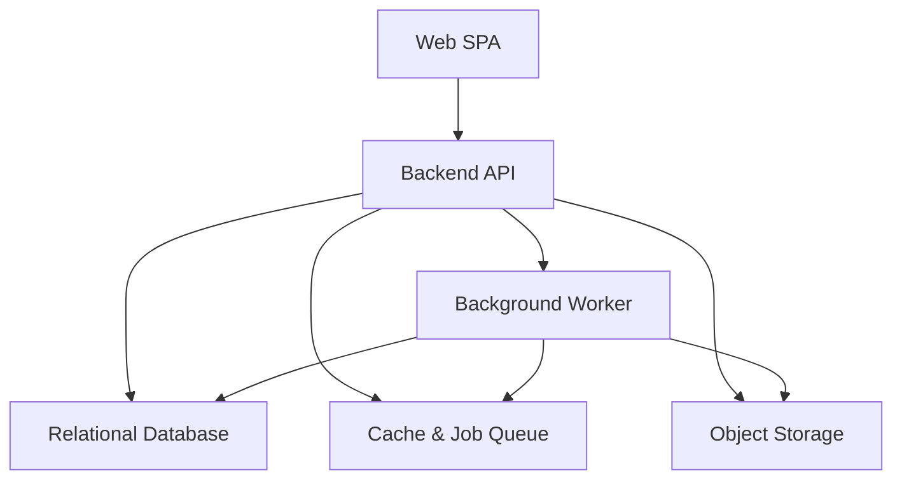
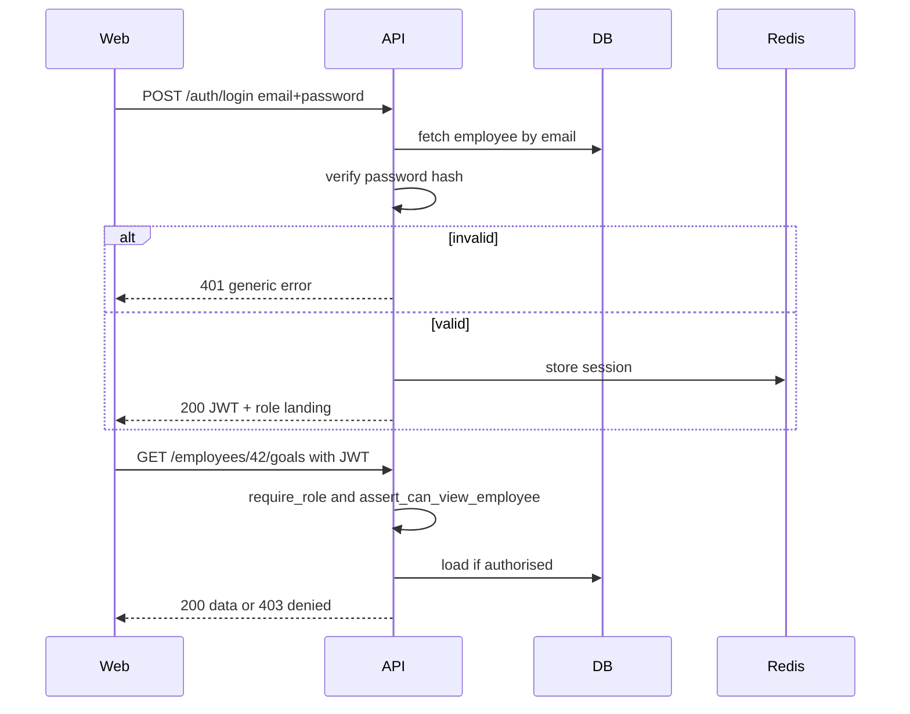
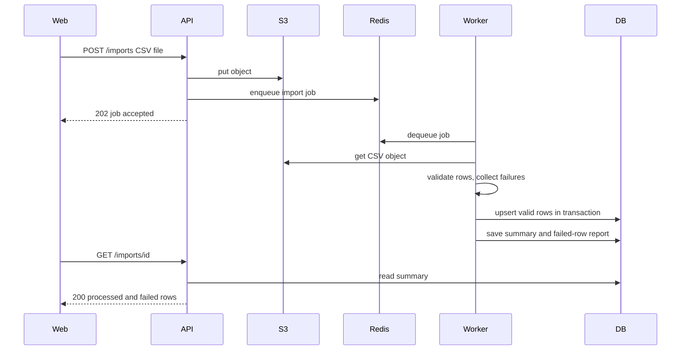
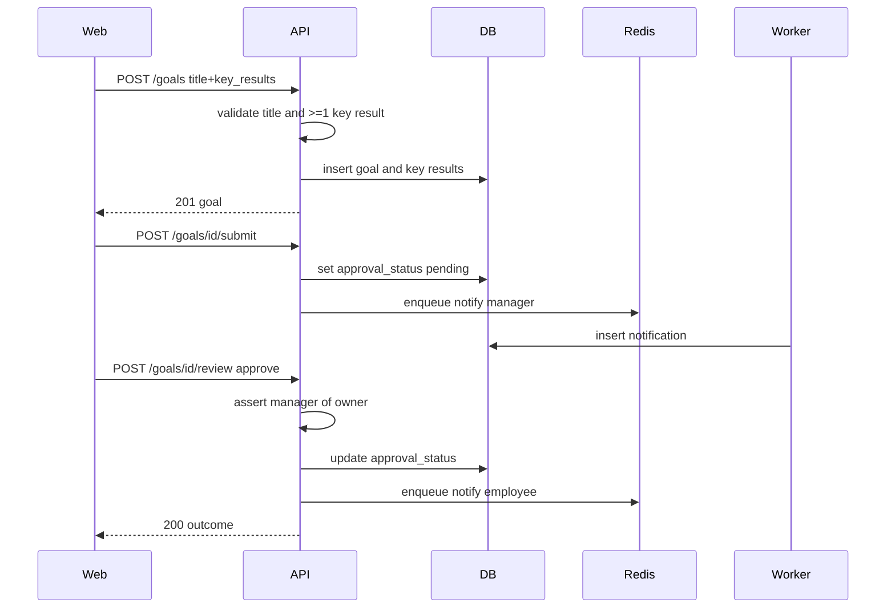
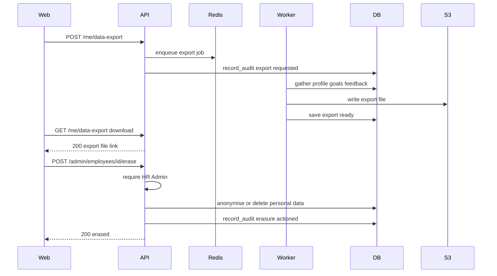
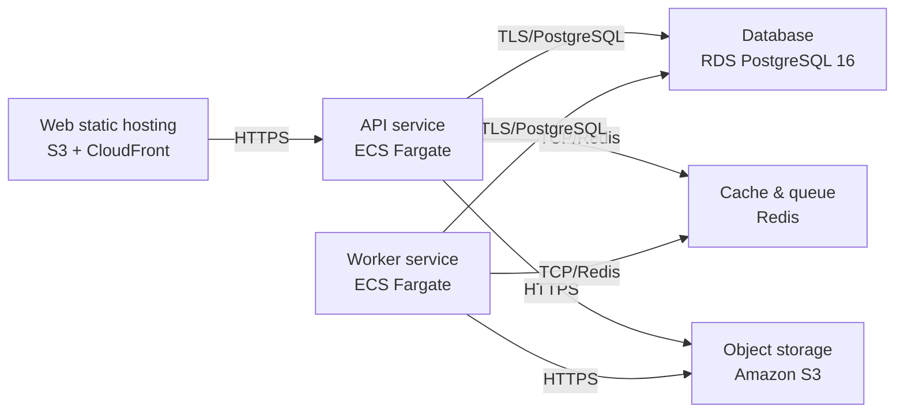

# Architecture

> Maintained by QuorQ AI SDLC. Text between `sdlc:auto` markers is regenerated; anything outside them is yours and is kept.

<!-- sdlc:auto:start narrative -->
## Overview

### ARCH-overview · approved · source: architecture:summary

Approved (v1) architecture for a lightweight performance management system serving a single multi-region org of up to a few thousand employees, on React 19 + FastAPI 0.115 + PostgreSQL 16 + AWS.

The system exposes REST APIs for email/password auth with JWT, RBAC across Employee/Manager/HR Admin, employee profiles and reporting hierarchy, CSV bulk import, OKR-style goals with key results and manager approval, continuous feedback and feedback requests, personal dashboards, in-app notifications, and GDPR-level data access/export/erasure/consent. A Redis-backed arq worker handles background work (CSV import, scheduled reminders, notification fan-out); Redis also caches dashboard aggregates and sessions. S3 holds uploaded CSVs and generated exports in the chosen EU region with encryption at rest/in transit and access audit logging for GDPR-level compliance.

- ⚠ No requirements-phase input was supplied alongside this architecture, so explicit links from architecture decisions to US-001..US-017 cannot be confirmed -- only inferred from functional description.
- ⚠ No approver name or approval date given for the v1 architecture sign-off.

### ARCH-component-web · approved · source: architecture:components:web

React 19 responsive SPA is the single front-end for all three roles (Employee/Manager/HR Admin).

Provides sign-in, dynamic goal/feedback forms, personal dashboards with charts, employee directory, CSV upload, notifications, and GDPR data export requests. Role-aware UI adapts to Employee/Manager/HR Admin permissions.

### ARCH-component-api · approved · source: architecture:components:api

FastAPI 0.115 backend is the sole REST API surface and enforcement point for RBAC, validation and audit logging.

Handles authentication, RBAC enforcement, profiles and hierarchy, goals/key results and approval, feedback, notifications, dashboards and GDPR access/export/erasure/consent. Validates and minimises input, writes audit logs, and enqueues background jobs rather than doing batch work inline.

### ARCH-component-worker · approved · source: architecture:components:worker

A FastAPI-based arq worker, backed by Redis, processes all queued and scheduled background jobs.

Responsibilities: CSV bulk import/update with per-row validation; deadline and feedback-request reminders plus in-app notification fan-out; and GDPR export/erasure processing. Decouples slow/batch work from the synchronous API request path.

### ARCH-component-db · approved · source: architecture:components:db

PostgreSQL 16 is the system of record for all relational data, hosted in the EU region for GDPR residency.

Stores employees, reporting hierarchy, goals, key results, feedback, feedback requests, notifications, consents and audit logs with referential integrity and transactional correctness. Encrypted at rest.

### ARCH-component-redis · approved · source: architecture:components:redis

Redis 7 serves two roles: cache for aggregates/sessions, and the job queue backing the worker.

Caches org-wide/dashboard aggregate results and user sessions to speed up read-heavy dashboard views; also backs the background job queue used by the arq worker for batch and scheduled work.

### ARCH-component-s3 · approved · source: architecture:components:s3

Amazon S3 durably stores uploaded CSV import files and generated CSV data exports, separate from the database.

Located in the chosen GDPR (EU) region with server-side encryption enabled.

### ARCH-critical-path-auth-rbac · approved · source: architecture:critical_paths:sign-in-rbac

Defines the sign-in and per-request authorisation flow underpinning all role-gated functionality.

User signs in with email and password via POST /auth/login, receives a JWT, and every subsequent request is authorised against the user's role and the manager-report relationship. Failed sign-in returns a single non-revealing error (tagged NFR-001 in the endpoint spec).

- ⚠ No explicit requirement id is attached to NFR-001 or this path in the provided input; likely maps to an auth/security-related user story but this cannot be confirmed without requirements-phase input.

### ARCH-critical-path-csv-import · approved · source: architecture:critical_paths:csv-bulk-import

HR Admin bulk-creates/updates employees and reporting relationships via an asynchronously validated CSV upload.

HR Admin uploads a CSV to S3 (POST /admin/imports); a background job (worker) validates each row, creates/updates employees and reporting relationships, rejects only failing rows, and records a processed summary without corrupting valid records. Summary retrievable via GET /admin/imports/{job_id}.

### ARCH-critical-path-goal-approval · approved · source: architecture:critical_paths:goal-creation-approval

Employee creates an OKR-style goal, tracks progress via key results, and submits it for manager approval.

Employee creates an objective with key results, updates progress which recalculates overall goal progress, then submits for approval. The manager (only for direct reports) approves or requests changes; the employee sees the outcome plus a notification.

### ARCH-critical-path-gdpr · approved · source: architecture:critical_paths:gdpr-export-erasure

GDPR: employee data export (right of access) and HR-actioned erasure, both fully audit-logged.

An employee requests an export of their profile, goals and feedback (POST /me/data-export). An HR Admin actions an approved erasure which removes or anonymises personal data per retention policy (POST /admin/employees/{id}/erase). All access and erasure actions are audit-logged (audit_logs entity).

- ⚠ GDPR: 'right to erasure' and 'right of access' controls -- the architecture documents export/erasure/audit-logging mechanisms, but retention-policy specifics (how long data is kept before/after erasure) are referenced only generically as 'per retention policy' with no concrete policy definition in this input.

### ARCH-data-model · approved · source: architecture:entities

Nine core entities define the relational data model: employees, goals, key_results, feedback, feedback_requests, notifications, consents, csv_import_jobs, audit_logs.

employees(id, name, email, password_hash, role, manager_id, status, is_anonymised, created_at, updated_at); goals(id, employee_id, title, description, status, progress, approval_status, created_at); key_results(id, goal_id, title, target_value, current_value, status); feedback(id, author_id, recipient_id, request_id, content, created_at); feedback_requests(id, requester_id, target_id, status, created_at); notifications(id, user_id, type, message, is_read, created_at); consents(id, employee_id, purpose, status, recorded_at); csv_import_jobs(id, uploaded_by, s3_key, status, summary, created_at); audit_logs(id, actor_id, action, entity, entity_id, details, created_at). Note: employees.is_anonymised directly supports the GDPR erasure critical path.

### ARCH-api-endpoints · approved · source: architecture:endpoints

19 REST endpoints cover auth, profile/admin management, CSV import, goals/approval, dashboards, feedback, notifications and GDPR actions.

Auth/profile: POST /auth/login (generic failure error, NFR-001), GET /me. Admin: POST /admin/employees, PATCH /admin/employees/{id}, POST /admin/imports, GET /admin/imports/{job_id}. Goals: POST /goals, PATCH /goals/{id}/key-results/{kr_id} (recalculates progress), POST /goals/{id}/submit, GET /employees/{id}/goals (manager-only, denied for non-reports), POST /goals/{id}/review. Dashboard: GET /dashboard (served from cache). Feedback: POST /feedback (empty content rejected), POST /feedback/requests, GET /feedback (own only, others denied). Notifications: GET /notifications, POST /notifications/{id}/read. GDPR: POST /me/data-export, POST /admin/employees/{id}/erase, POST /me/consent.

### ARCH-deployment · approved · source: architecture:deployment_nodes

Deployment topology: static web hosting + Fargate services + managed data stores, all on AWS.

Web: S3 + CloudFront static hosting serving the React 19 build. API: ECS Fargate running FastAPI 0.115 on uvicorn. Worker: ECS Fargate running the FastAPI/arq background worker. Database: RDS PostgreSQL 16. Cache & queue: Redis (redis:7-alpine container). Object storage: S3 bucket in the EU region with SSE enabled.

### ARCH-tech-decisions · approved · source: architecture:technology_decisions

Four stack decisions were made, each with alternatives considered and a stated rationale tied to the system's needs.

Frontend: React 19 (vs Vue, Angular) -- chosen to render the form-heavy, role-aware interface (dynamic goal/key-result and feedback forms, three role dashboards with charts, CSV upload) as a responsive SPA for desktop and mobile. Backend: FastAPI 0.115 (vs Django REST Framework, Flask) -- chosen to host business logic (RBAC, goal approval flow, CSV import, GDPR export/erasure) with Pydantic validation enforcing data minimisation and strict input handling. Database: PostgreSQL 16 (vs MySQL, SQL Server) -- chosen for the highly relational model (employees, hierarchy, goals, key results, feedback), transactional integrity, dashboard aggregation queries, and row-level controls/auditability for GDPR. Cloud: AWS (vs Azure, GCP) -- chosen to keep all data in a single EU region using managed RDS, S3 and VPC networking for an internal tool with GDPR residency and deletion requirements.
<!-- sdlc:auto:end narrative -->

<!-- sdlc:auto:start building-blocks -->
## Building Block View

| ID | Name | Technology | Responsibility | Depends on |
|---|---|---|---|---|
| web | Web SPA | React 19 | Responsive, role-aware UI for sign-in, dynamic goal/feedback forms, personal dashboards with charts, employee directory, CSV upload, notifications and GDPR data export requests. | api |
| api | Backend API | FastAPI 0.115 | REST API for authentication, RBAC enforcement, profiles and hierarchy, goals/key results and approval, feedback, notifications, dashboards and GDPR access/export/erasure/consent. Validates and minimises input, writes audit logs, enqueues background jobs. | db, redis, s3, worker |
| worker | Background Worker | FastAPI 0.115 (Python arq worker) | Processes queued and scheduled jobs: CSV bulk import/update with per-row validation, deadline/feedback-request reminders and in-app notification fan-out, and GDPR export/erasure processing. | db, redis, s3 |
| db | Relational Database | PostgreSQL 16 | Stores employees, reporting hierarchy, goals, key results, feedback, feedback requests, notifications, consents and audit logs with referential integrity and transactional correctness. Encrypted at rest, hosted in the EU region for GDPR residency. | — |
| redis | Cache & Job Queue | Redis 7 | Caches org-wide/dashboard aggregate results and user sessions, and backs the background job queue for batch and scheduled work. | — |
| s3 | Object Storage | Amazon S3 | Durably stores uploaded CSV import files and generated CSV data exports in the chosen GDPR region, separate from the database, with server-side encryption. | — |

<!-- sdlc:auto:end building-blocks -->

<!-- sdlc:auto:start runtime -->
## Runtime View

### Sign-in and RBAC enforcement

User signs in with email and password, receives a JWT, and every subsequent request is authorised against the user's role and the manager-report relationship. Failed sign-in returns a single non-revealing error.

- **Components:** web, api, db, redis
- **Modules:** auth.router, auth.security, rbac.dependencies, audit.service
- **Key functions:** login(email, password), verify_password(raw, hash), create_access_token(user), require_role(role), assert_can_view_employee(actor, target_id)

### CSV bulk import of employees

HR Admin uploads a CSV to S3, a background job validates each row, creates/updates employees and reporting relationships, rejects only failing rows and records a processed summary without corrupting valid records.

- **Components:** web, api, s3, redis, worker, db
- **Modules:** imports.router, imports.service, worker.csv_import, employees.repository
- **Key functions:** upload_csv(file), enqueue_import(job_id, s3_key), process_csv(job_id), validate_row(row), upsert_employee(row), write_import_summary(job_id, results)

### Goal creation and manager approval

Employee creates an objective with key results, updates progress which recalculates overall goal progress, submits for approval; the manager (only for direct reports) approves or requests changes and the employee sees the outcome plus a notification.

- **Components:** web, api, db, redis, worker
- **Modules:** goals.router, goals.service, goals.progress, rbac.dependencies, notifications.service
- **Key functions:** create_goal(employee_id, payload), update_key_result(kr_id, value, status), recalculate_goal_progress(goal_id), submit_for_approval(goal_id), review_goal(goal_id, decision, manager_id), notify(user_id, event)

### GDPR data export and erasure

An employee requests an export of their profile, goals and feedback; an HR Admin actions an approved erasure which removes or anonymises personal data per retention policy. All access and erasure actions are audit-logged.

- **Components:** web, api, worker, s3, db, redis
- **Modules:** gdpr.router, gdpr.export_service, gdpr.erasure_service, audit.service
- **Key functions:** request_export(employee_id), build_export_bundle(employee_id), action_erasure(employee_id), anonymise_employee(employee_id), record_audit(actor, action, entity_id)

<!-- sdlc:auto:end runtime -->

<!-- sdlc:auto:start deployment-view -->
## Deployment View

| Name | Service | Runtime | Scaling | Environment |
|---|---|---|---|---|
| Web static hosting | S3 + CloudFront | React 19 build | CDN edge | dev |
| API service | ECS Fargate | FastAPI 0.115 (Python/uvicorn) | horizontal, 1-3 tasks | dev |
| Worker service | ECS Fargate | FastAPI 0.115 (Python arq worker) | horizontal, 1-2 tasks | dev |
| Database | RDS PostgreSQL 16 | PostgreSQL 16 | single instance (EU region, encrypted at rest) | dev |
| Cache & queue | Redis | redis:7-alpine container | single instance | dev |
| Object storage | Amazon S3 | S3 bucket (EU region, SSE enabled) | managed | dev |

| Source | Target | Protocol |
|---|---|---|
| Web static hosting | API service | HTTPS |
| API service | Database | TLS/PostgreSQL |
| API service | Cache & queue | TCP/Redis |
| API service | Object storage | HTTPS |
| Worker service | Database | TLS/PostgreSQL |
| Worker service | Cache & queue | TCP/Redis |
| Worker service | Object storage | HTTPS |

<!-- sdlc:auto:end deployment-view -->

<!-- sdlc:auto:start decisions -->
## Architecture Decisions

| Layer | Choice | ADR |
|---|---|---|
| Frontend | React 19 | [ADR-0001](adr/frontend.md) |
| Backend | FastAPI 0.115 | [ADR-0002](adr/backend.md) |
| Database | PostgreSQL 16 | [ADR-0003](adr/database.md) |
| Cloud | AWS | [ADR-0004](adr/cloud.md) |
<!-- sdlc:auto:end decisions -->

<!-- sdlc:auto:start links -->
## Related Documents

- [Data Model](data-model.md)
- [API Specification](api/openapi.yaml)
- [Architecture Decision Records](adr/README.md)
<!-- sdlc:auto:end links -->
