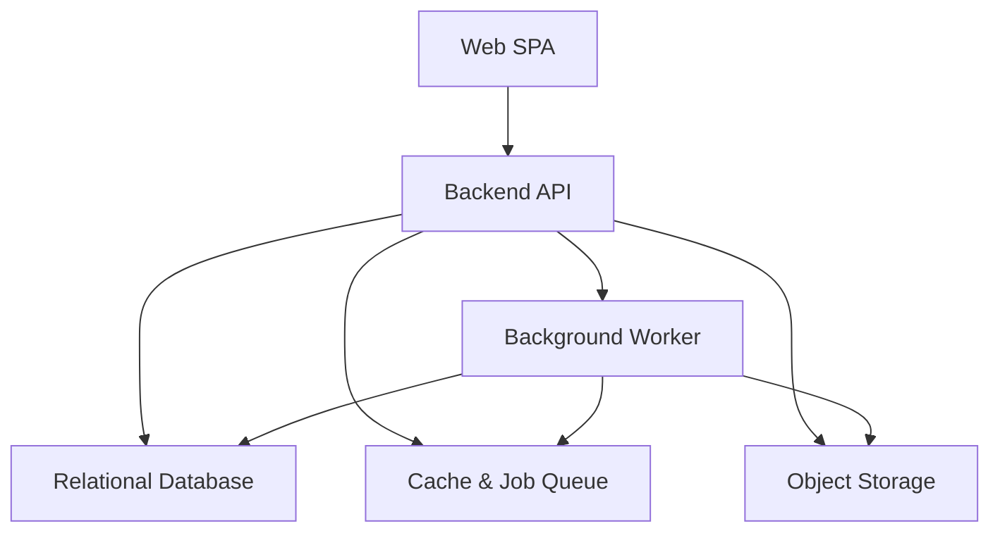
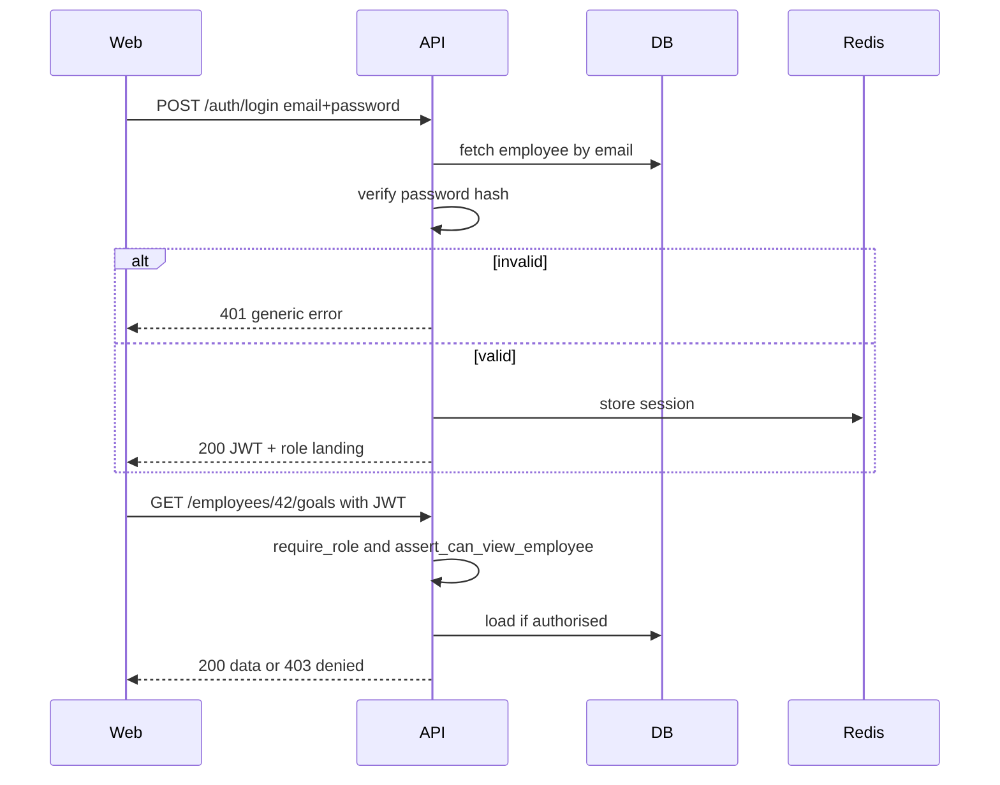
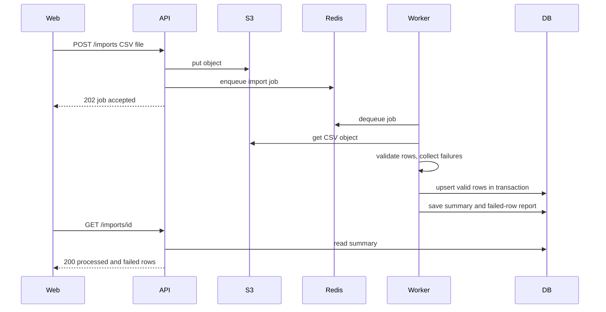
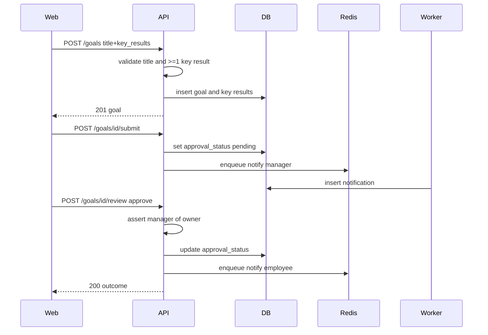
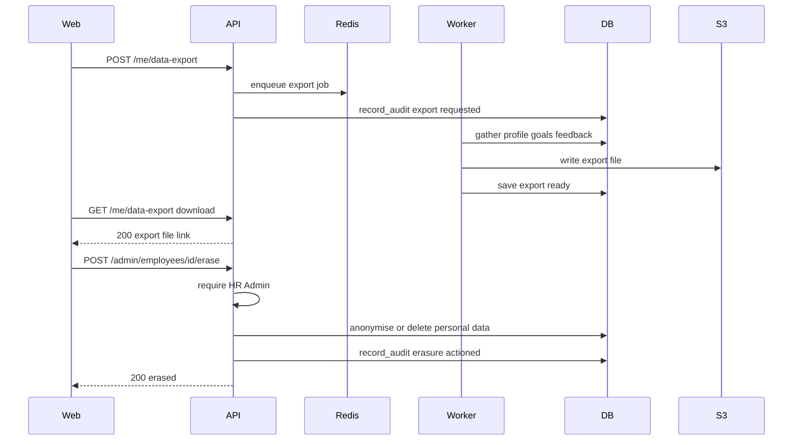
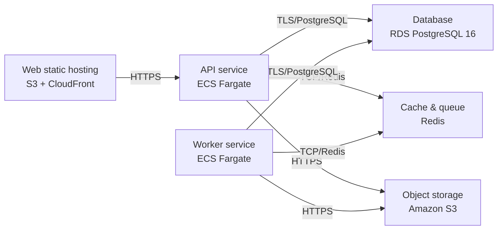

# Architecture

> Maintained by QuorQ AI SDLC. Text between `sdlc:auto` markers is regenerated; anything outside them is yours and is kept.

<!-- sdlc:auto:start narrative -->
## Overview

### ARCH-001 · approved · source: architecture:overview

Approved v1 architecture: React 19 SPA, FastAPI 0.115 REST API, PostgreSQL 16, Redis (cache+queue), an arq background worker, and S3, hosted on AWS in the EU region for GDPR residency.

Components: web (React 19 SPA — sign-in, dynamic goal/feedback forms, dashboards, directory, CSV upload, notifications, GDPR export requests); api (FastAPI 0.115 — auth, RBAC, profiles/hierarchy, goals/approval, feedback, notifications, dashboards, GDPR access/export/erasure/consent; validates/minimises input, writes audit logs, enqueues jobs); worker (FastAPI/arq — CSV import with per-row validation, reminders, notification fan-out, GDPR export/erasure processing); db (PostgreSQL 16 — employees, hierarchy, goals, key results, feedback, consents, audit logs; encrypted at rest, EU-hosted); redis (Redis 7 — dashboard/session cache + job queue); s3 (S3 — CSV uploads and generated exports, EU region, server-side encryption).
Entities: employees, goals, key_results, feedback, feedback_requests, notifications, consents, csv_import_jobs, audit_logs.
Endpoints: POST /auth/login; GET /me; POST /admin/employees; PATCH /admin/employees/{id}; POST /admin/imports; GET /admin/imports/{job_id}; POST /goals; PATCH /goals/{id}/key-results/{kr_id}; POST /goals/{id}/submit; GET /employees/{id}/goals; POST /goals/{id}/review; GET /dashboard; POST /feedback; POST /feedback/requests; GET /feedback; GET /notifications; POST /notifications/{id}/read; POST /me/data-export; POST /admin/employees/{id}/erase; POST /me/consent.
Deployment nodes: web static hosting (S3+CloudFront); API service (ECS Fargate, uvicorn); Worker service (ECS Fargate, arq); Database (RDS PostgreSQL 16); Cache & queue (Redis 7 container); Object storage (S3 bucket, EU region, SSE enabled).

**Related:** EPIC-001, EPIC-002, EPIC-003, EPIC-004, EPIC-005, EPIC-006, EPIC-007

### ARCH-002 · approved · source: architecture:critical_path:sign-in-rbac

Sign-in and RBAC enforcement critical path: JWT-based auth followed by per-request role and manager-report authorisation.

User signs in via POST /auth/login with email/password and receives a JWT; every subsequent request is authorised against the user's role (employees table) and the manager-report relationship (manager_id). A failed sign-in returns a single non-revealing error, satisfying NFR-001.

**Related:** EPIC-001, US-001, US-002, NFR-001, NFR-002

### ARCH-003 · approved · source: architecture:critical_path:csv-import

CSV bulk import critical path: file goes to S3, a background job validates and applies rows, failures are isolated and reported.

HR Admin uploads a CSV via POST /admin/imports; the file is stored in S3 (csv_import_jobs.s3_key) and the import is queued. A background worker job validates each row and creates/updates employees and reporting relationships; only failing rows are rejected, leaving valid rows intact (NFR-009). GET /admin/imports/{job_id} returns the processed/failed summary with reasons. This matches NFR-006's requirement that batch work run off the request path.

**Related:** EPIC-002, US-005, NFR-006, NFR-009

### ARCH-004 · approved · source: architecture:critical_path:goal-approval

Goal creation and manager approval critical path, from objective creation through progress tracking to manager review.

POST /goals creates an objective with one or more key results. PATCH /goals/{id}/key-results/{kr_id} updates a key result's progress/status and recalculates overall goal progress. POST /goals/{id}/submit submits the goal for approval. GET /employees/{id}/goals lets a manager view a direct report's goals (denied for non-reports). POST /goals/{id}/review lets the manager approve or request changes; the employee sees the outcome plus a notification.

**Related:** EPIC-003, US-007, US-008, US-009

### ARCH-005 · approved · source: architecture:critical_path:gdpr

GDPR data export and erasure critical path, with all access/erasure actions audit-logged and data held in the EU region.

POST /me/data-export lets an employee request an export of their profile, goals and feedback data; the worker processes GDPR export/erasure jobs. POST /admin/employees/{id}/erase lets an HR Admin action an approved erasure, removing or anonymising personal data per retention policy. POST /me/consent records/updates consent status per processing purpose. All access and erasure actions are written to audit_logs. Data sits in RDS (PostgreSQL 16) and S3, both EU-region, encrypted at rest and in transit.

**Related:** EPIC-007, US-015, US-016, US-017, NFR-003, NFR-004

- ⚠ Architecture does not specify the export delivery mechanism in detail (e.g., synchronous response vs. async download link) beyond 'worker processes ... GDPR export/erasure processing'.

### ARCH-006 · approved · source: architecture:technology_decisions

Architecture's chosen stack matches the product-owner-approved stack from requirements exactly, with documented rejected alternatives.

- Frontend: React 19 (alternatives considered: Vue, Angular) — renders the form-heavy, role-aware SPA (goal/key-result forms, feedback forms, three role dashboards, CSV upload).
- Backend: FastAPI 0.115 (alternatives: Django REST Framework, Flask) — hosts RBAC, goal approval flow, CSV import and GDPR export/erasure logic; Pydantic validation enforces data minimisation and strict input handling.
- Database: PostgreSQL 16 (alternatives: MySQL, SQL Server) — enforces the relational model (employees, hierarchy, goals, key results, feedback) transactionally and supports row-level controls/auditability for GDPR.
- Cloud: AWS (alternatives: Azure, GCP) — keeps data in a chosen EU region with managed RDS, S3 and VPC networking for an internal tool.
No discrepancies found between the requirements-approved stack/services and the architecture's chosen components.

**Related:** REQ-SCOPE
<!-- sdlc:auto:end narrative -->

<!-- sdlc:auto:start building-blocks -->
## Building Block View

| ID | Name | Technology | Responsibility | Depends on |
|---|---|---|---|---|
| web | Web SPA | React 19 | Responsive, role-aware UI for sign-in, dynamic goal/feedback forms, personal dashboards with charts, employee directory, CSV upload, notifications and GDPR data export requests. | api |
| api | Backend API | FastAPI 0.115 | REST API for authentication, RBAC enforcement, profiles and hierarchy, goals/key results and approval, feedback, notifications, dashboards and GDPR access/export/erasure/consent. Validates and minimises input, writes audit logs, enqueues background jobs. | db, redis, s3, worker |
| worker | Background Worker | FastAPI 0.115 (Python arq worker) | Processes queued and scheduled jobs: CSV bulk import/update with per-row validation, deadline/feedback-request reminders and in-app notification fan-out, and GDPR export/erasure processing. | db, redis, s3 |
| db | Relational Database | PostgreSQL 16 | Stores employees, reporting hierarchy, goals, key results, feedback, feedback requests, notifications, consents and audit logs with referential integrity and transactional correctness. Encrypted at rest, hosted in the EU region for GDPR residency. | — |
| redis | Cache & Job Queue | Redis 7 | Caches org-wide/dashboard aggregate results and user sessions, and backs the background job queue for batch and scheduled work. | — |
| s3 | Object Storage | Amazon S3 | Durably stores uploaded CSV import files and generated CSV data exports in the chosen GDPR region, separate from the database, with server-side encryption. | — |

<!-- sdlc:auto:end building-blocks -->

<!-- sdlc:auto:start runtime -->
## Runtime View

### Sign-in and RBAC enforcement

User signs in with email and password, receives a JWT, and every subsequent request is authorised against the user's role and the manager-report relationship. Failed sign-in returns a single non-revealing error.

- **Components:** web, api, db, redis
- **Modules:** auth.router, auth.security, rbac.dependencies, audit.service
- **Key functions:** login(email, password), verify_password(raw, hash), create_access_token(user), require_role(role), assert_can_view_employee(actor, target_id)

### CSV bulk import of employees

HR Admin uploads a CSV to S3, a background job validates each row, creates/updates employees and reporting relationships, rejects only failing rows and records a processed summary without corrupting valid records.

- **Components:** web, api, s3, redis, worker, db
- **Modules:** imports.router, imports.service, worker.csv_import, employees.repository
- **Key functions:** upload_csv(file), enqueue_import(job_id, s3_key), process_csv(job_id), validate_row(row), upsert_employee(row), write_import_summary(job_id, results)

### Goal creation and manager approval

Employee creates an objective with key results, updates progress which recalculates overall goal progress, submits for approval; the manager (only for direct reports) approves or requests changes and the employee sees the outcome plus a notification.

- **Components:** web, api, db, redis, worker
- **Modules:** goals.router, goals.service, goals.progress, rbac.dependencies, notifications.service
- **Key functions:** create_goal(employee_id, payload), update_key_result(kr_id, value, status), recalculate_goal_progress(goal_id), submit_for_approval(goal_id), review_goal(goal_id, decision, manager_id), notify(user_id, event)

### GDPR data export and erasure

An employee requests an export of their profile, goals and feedback; an HR Admin actions an approved erasure which removes or anonymises personal data per retention policy. All access and erasure actions are audit-logged.

- **Components:** web, api, worker, s3, db, redis
- **Modules:** gdpr.router, gdpr.export_service, gdpr.erasure_service, audit.service
- **Key functions:** request_export(employee_id), build_export_bundle(employee_id), action_erasure(employee_id), anonymise_employee(employee_id), record_audit(actor, action, entity_id)

<!-- sdlc:auto:end runtime -->

<!-- sdlc:auto:start deployment-view -->
## Deployment View

| Name | Service | Runtime | Scaling | Environment |
|---|---|---|---|---|
| Web static hosting | S3 + CloudFront | React 19 build | CDN edge | dev |
| API service | ECS Fargate | FastAPI 0.115 (Python/uvicorn) | horizontal, 1-3 tasks | dev |
| Worker service | ECS Fargate | FastAPI 0.115 (Python arq worker) | horizontal, 1-2 tasks | dev |
| Database | RDS PostgreSQL 16 | PostgreSQL 16 | single instance (EU region, encrypted at rest) | dev |
| Cache & queue | Redis | redis:7-alpine container | single instance | dev |
| Object storage | Amazon S3 | S3 bucket (EU region, SSE enabled) | managed | dev |

| Source | Target | Protocol |
|---|---|---|
| Web static hosting | API service | HTTPS |
| API service | Database | TLS/PostgreSQL |
| API service | Cache & queue | TCP/Redis |
| API service | Object storage | HTTPS |
| Worker service | Database | TLS/PostgreSQL |
| Worker service | Cache & queue | TCP/Redis |
| Worker service | Object storage | HTTPS |

<!-- sdlc:auto:end deployment-view -->

<!-- sdlc:auto:start decisions -->
## Architecture Decisions

| Layer | Choice | ADR |
|---|---|---|
| Frontend | React 19 | [ADR-0001](adr/frontend.md) |
| Backend | FastAPI 0.115 | [ADR-0002](adr/backend.md) |
| Database | PostgreSQL 16 | [ADR-0003](adr/database.md) |
| Cloud | AWS | [ADR-0004](adr/cloud.md) |
<!-- sdlc:auto:end decisions -->

<!-- sdlc:auto:start links -->
## Related Documents

- [Data Model](data-model.md)
- [API Specification](api/openapi.yaml)
- [Architecture Decision Records](adr/README.md)
<!-- sdlc:auto:end links -->
