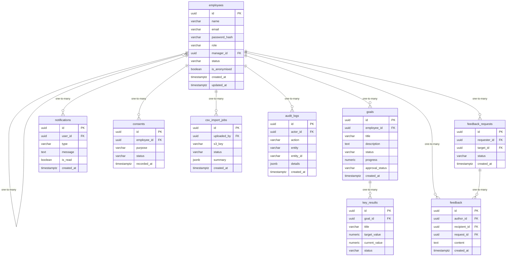

# Data Model

<!-- sdlc:auto:start entities -->
### employees

| Field | Type | PK | FK | Nullable |
|---|---|---|---|---|
| id | uuid | True | — | False |
| name | varchar | False | — | False |
| email | varchar | False | — | False |
| password_hash | varchar | False | — | True |
| role | varchar | False | — | False |
| manager_id | uuid | False | employees.id | True |
| status | varchar | False | — | False |
| is_anonymised | boolean | False | — | False |
| created_at | timestamptz | False | — | False |
| updated_at | timestamptz | False | — | False |

### goals

| Field | Type | PK | FK | Nullable |
|---|---|---|---|---|
| id | uuid | True | — | False |
| employee_id | uuid | False | employees.id | False |
| title | varchar | False | — | False |
| description | text | False | — | True |
| status | varchar | False | — | False |
| progress | numeric | False | — | False |
| approval_status | varchar | False | — | False |
| created_at | timestamptz | False | — | False |

### key_results

| Field | Type | PK | FK | Nullable |
|---|---|---|---|---|
| id | uuid | True | — | False |
| goal_id | uuid | False | goals.id | False |
| title | varchar | False | — | False |
| target_value | numeric | False | — | True |
| current_value | numeric | False | — | False |
| status | varchar | False | — | False |

### feedback

| Field | Type | PK | FK | Nullable |
|---|---|---|---|---|
| id | uuid | True | — | False |
| author_id | uuid | False | employees.id | False |
| recipient_id | uuid | False | employees.id | False |
| request_id | uuid | False | feedback_requests.id | True |
| content | text | False | — | False |
| created_at | timestamptz | False | — | False |

### feedback_requests

| Field | Type | PK | FK | Nullable |
|---|---|---|---|---|
| id | uuid | True | — | False |
| requester_id | uuid | False | employees.id | False |
| target_id | uuid | False | employees.id | False |
| status | varchar | False | — | False |
| created_at | timestamptz | False | — | False |

### notifications

| Field | Type | PK | FK | Nullable |
|---|---|---|---|---|
| id | uuid | True | — | False |
| user_id | uuid | False | employees.id | False |
| type | varchar | False | — | False |
| message | text | False | — | False |
| is_read | boolean | False | — | False |
| created_at | timestamptz | False | — | False |

### consents

| Field | Type | PK | FK | Nullable |
|---|---|---|---|---|
| id | uuid | True | — | False |
| employee_id | uuid | False | employees.id | False |
| purpose | varchar | False | — | False |
| status | varchar | False | — | False |
| recorded_at | timestamptz | False | — | False |

### csv_import_jobs

| Field | Type | PK | FK | Nullable |
|---|---|---|---|---|
| id | uuid | True | — | False |
| uploaded_by | uuid | False | employees.id | False |
| s3_key | varchar | False | — | False |
| status | varchar | False | — | False |
| summary | jsonb | False | — | True |
| created_at | timestamptz | False | — | False |

### audit_logs

| Field | Type | PK | FK | Nullable |
|---|---|---|---|---|
| id | uuid | True | — | False |
| actor_id | uuid | False | employees.id | True |
| action | varchar | False | — | False |
| entity | varchar | False | — | False |
| entity_id | varchar | False | — | True |
| details | jsonb | False | — | True |
| created_at | timestamptz | False | — | False |
<!-- sdlc:auto:end entities -->

<!-- sdlc:auto:start relationships -->
| Source | Target | Type |
|---|---|---|
| employees | employees | one-to-many |
| employees | goals | one-to-many |
| goals | key_results | one-to-many |
| employees | feedback | one-to-many |
| feedback_requests | feedback | one-to-many |
| employees | feedback_requests | one-to-many |
| employees | notifications | one-to-many |
| employees | consents | one-to-many |
| employees | csv_import_jobs | one-to-many |
| employees | audit_logs | one-to-many |
<!-- sdlc:auto:end relationships -->

<!-- sdlc:auto:start er-diagram -->

<!-- sdlc:auto:end er-diagram -->
