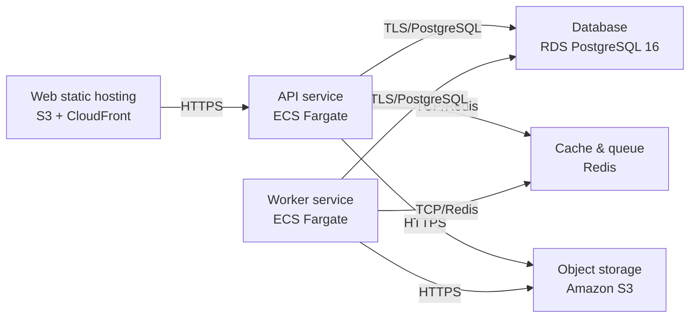

# Deployment Guide

> Maintained by QuorQ AI SDLC. Text between `sdlc:auto` markers is regenerated; anything outside them is yours and is kept.

<!-- sdlc:auto:start how-it-deploys -->
Pushes to `main` run `.github/workflows/deploy.yml`, which builds the API image (if there is a backend) and deploys the SPA to AWS Amplify. Commits touching only `docs/sdlc/**` don't deploy. Deployments can also be started from the platform's Deployment tab.
<!-- sdlc:auto:end how-it-deploys -->

<!-- sdlc:auto:start environments -->
| Name | Service | Runtime | Scaling | Environment |
|---|---|---|---|---|
| Web static hosting | S3 + CloudFront | React 19 build | CDN edge | dev |
| API service | ECS Fargate | FastAPI 0.115 (Python/uvicorn) | horizontal, 1-3 tasks | dev |
| Worker service | ECS Fargate | FastAPI 0.115 (Python arq worker) | horizontal, 1-2 tasks | dev |
| Database | RDS PostgreSQL 16 | PostgreSQL 16 | single instance (EU region, encrypted at rest) | dev |
| Cache & queue | Redis | redis:7-alpine container | single instance | dev |
| Object storage | Amazon S3 | S3 bucket (EU region, SSE enabled) | managed | dev |
<!-- sdlc:auto:end environments -->

<!-- sdlc:auto:start live -->
_Not deployed yet._
<!-- sdlc:auto:end live -->

<!-- sdlc:auto:start topology -->

<!-- sdlc:auto:end topology -->
